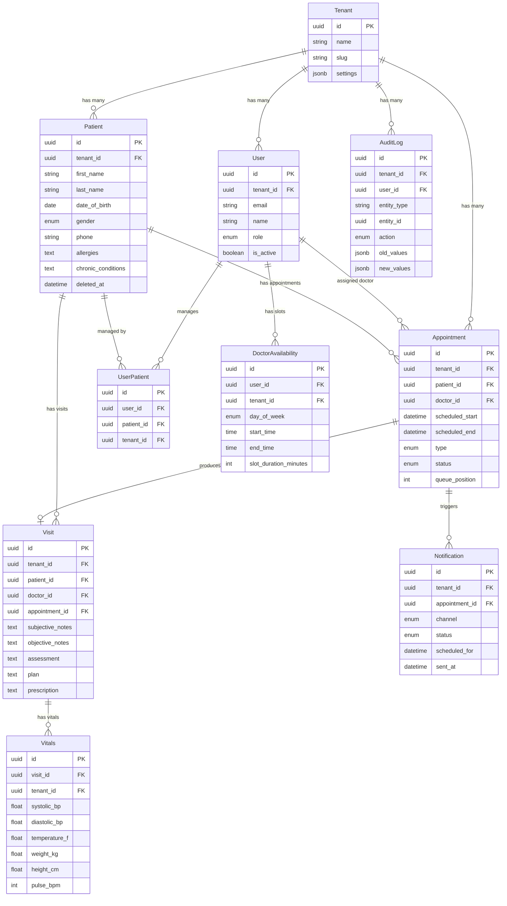
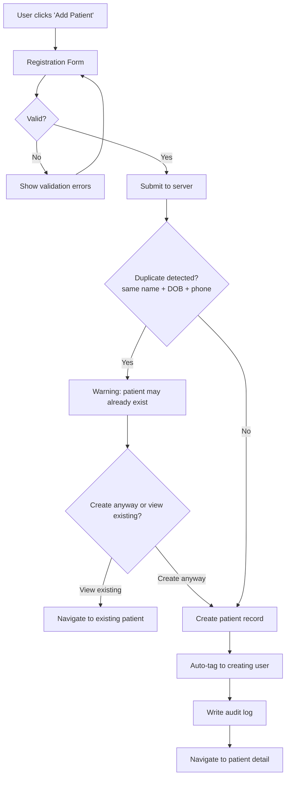
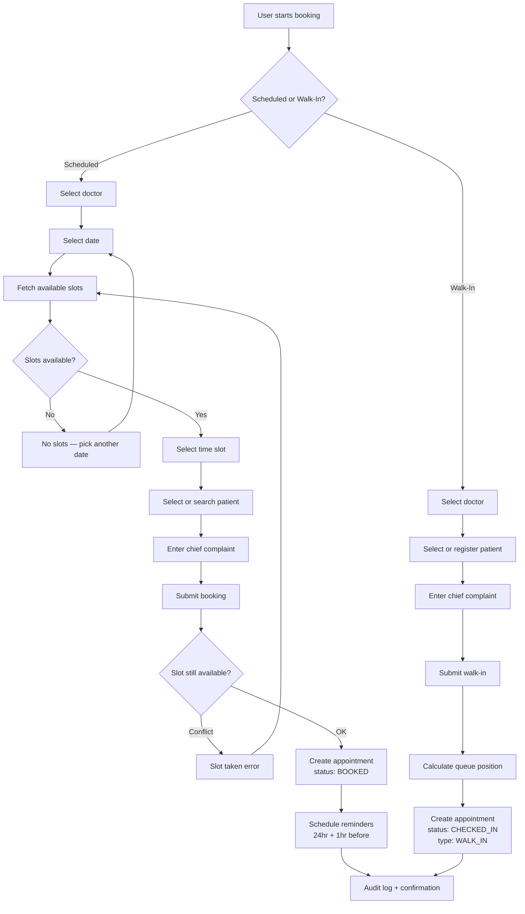
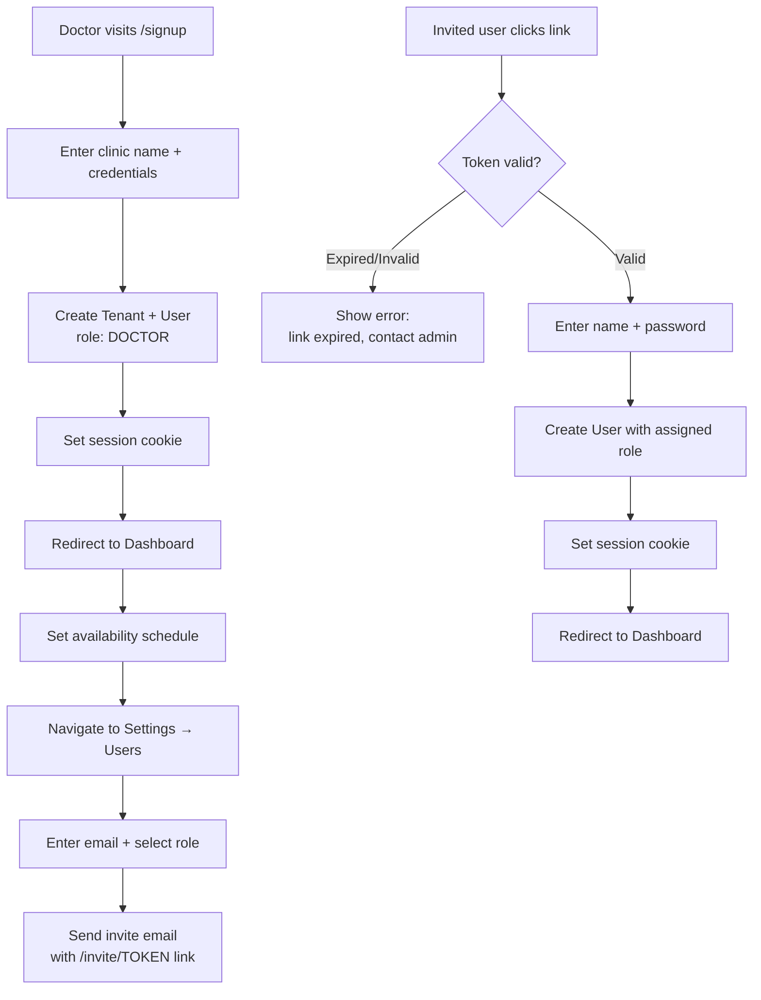
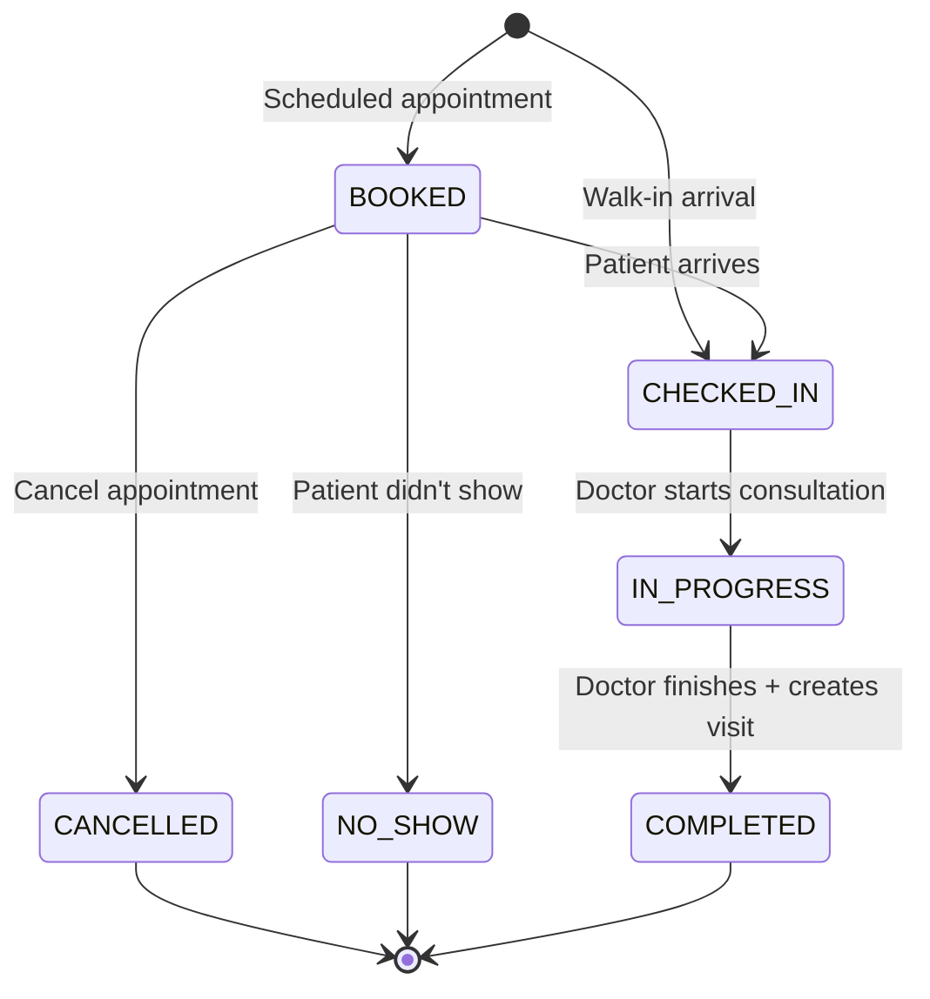

# Hospital ERP Manager

A multi-tenant SaaS platform for small clinics and hospitals to manage operations with minimal staff. Built for doctor-owned practices with 5-10 users per clinic.

---

## Problem

Small clinics depend heavily on manual coordination — paper registers, phone-based appointment booking, and receptionist-driven workflows. This creates bottlenecks, errors, and a need for more staff than necessary.

## Solution

A focused ERP that digitizes the two highest-impact workflows first — **patient registration** and **appointment scheduling** — with an extensible architecture that supports AI features in the future.

---

## Tech Stack

| Layer | Technology | Rationale |
|-------|-----------|-----------|
| Framework | Next.js 14+ (App Router) | SSR/SSG, colocated API routes, single deployable |
| Language | TypeScript (strict mode) | End-to-end type safety |
| UI | shadcn/ui + Tailwind CSS | Accessible, customizable, no vendor lock-in |
| API | tRPC | Type-safe RPC, zero code generation |
| ORM | Prisma | Type-safe queries, migrations, excellent DX |
| Database | PostgreSQL | JSONB flexibility, full-text search, row-level security |
| Auth | NextAuth.js v5 (Auth.js) | Multi-provider, session management |
| Validation | Zod | Shared schemas between frontend and backend |
| Background Jobs | Inngest / BullMQ | Notification scheduling, retries |
| Notifications | Twilio (SMS + WhatsApp) | Single vendor for both channels |
| File Storage | AWS S3 / Cloudflare R2 | Prescription uploads, lab reports |
| Linting | Biome | Fast, single config for lint + format |
| Testing | Vitest + Playwright | Unit/integration + E2E |
| Hosting | Vercel + Supabase/AWS RDS | Low-ops for a startup |

---

## Architecture

### Multi-Tenancy

Shared database, shared schema, `tenant_id` column on every table. Prisma middleware auto-injects `WHERE tenant_id = ?` on every query.

### Project Structure

```
hospital-erp/
├── prisma/
│   ├── schema.prisma
│   ├── migrations/
│   └── seed.ts
├── src/
│   ├── app/                        # Next.js App Router
│   │   ├── (auth)/                 # Login, signup, invite
│   │   ├── (dashboard)/            # Authenticated pages
│   │   │   ├── patients/
│   │   │   ├── appointments/
│   │   │   ├── schedule/
│   │   │   └── settings/
│   │   └── api/trpc/[trpc]/
│   ├── server/
│   │   ├── trpc/routers/           # One router per domain
│   │   ├── services/               # Business logic
│   │   ├── db/                     # Prisma client + tenant middleware
│   │   └── jobs/                   # Background job processors
│   ├── lib/
│   │   ├── validators/             # Zod schemas (shared FE/BE)
│   │   ├── permissions.ts          # RBAC role-permission map
│   │   └── env.ts                  # Env var validation
│   ├── components/
│   │   ├── ui/                     # shadcn/ui primitives
│   │   ├── forms/
│   │   ├── tables/
│   │   └── layout/
│   └── hooks/
├── docs/specs/                     # Feature specs (spec-driven dev)
├── e2e/                            # Playwright E2E tests
├── biome.json
├── tsconfig.json
└── package.json
```

---

## Data Model



### Key Enums

| Enum | Values |
|------|--------|
| Role | `DOCTOR`, `RECEPTIONIST` (extensible) |
| AppointmentType | `SCHEDULED`, `WALK_IN` |
| AppointmentStatus | `BOOKED`, `CHECKED_IN`, `IN_PROGRESS`, `COMPLETED`, `CANCELLED`, `NO_SHOW` |
| NotificationChannel | `SMS`, `WHATSAPP` |
| Gender | `MALE`, `FEMALE`, `OTHER`, `PREFER_NOT_TO_SAY` |

---

## Modules

### Auth & Tenant Management

- Tenant signup creates the clinic and first doctor user
- Email/password login with bcrypt, HTTP-only session cookies
- JWT embeds `tenantId` and `role` for every request
- Invite users by email with role assignment
- RBAC via role-permission map (code-based, DB-driven later)

### Patient Management

- Full CRUD with demographics, medical info, allergies, chronic conditions
- Patients tagged to individual users (not roles) via `UserPatient` junction table
- Auto-tag to creating user on registration
- Duplicate detection: same name + DOB + phone triggers a warning
- PostgreSQL full-text search (`tsvector` + GIN index) on name and phone
- Soft-delete only — never hard-delete patient data

### Appointment Scheduling

- Doctors define weekly recurring availability (day, start/end time, slot duration)
- Block specific dates for vacation/holidays
- Slot generation: `availableSlots = allSlots - bookedSlots`
- Scheduled booking with real-time conflict detection
- Walk-in queue: auto-incrementing position, skips slot validation
- Status lifecycle: `BOOKED → CHECKED_IN → IN_PROGRESS → COMPLETED`
- Calendar view (day/week) for doctors, list view for receptionists

### Visits & Vitals

- Visit created from appointment (linked via `appointment_id`)
- SOAP notes: 4 separate fields (Subjective, Objective, Assessment, Plan)
- Vitals: BP, temperature, weight, height, pulse, SpO2
- Prescription text + file attachments (S3/R2)

### Notifications

- SMS + WhatsApp via Twilio
- Auto-scheduled reminders: 24hr and 1hr before appointment
- Cancelled on appointment cancellation
- Fire-and-forget with retry queue (max 3 attempts)

---

## Flowcharts

### Patient Registration



### Appointment Booking



### User Onboarding



### Appointment Status Lifecycle



---

## RBAC — Permission Matrix

| Permission | Doctor | Receptionist |
|-----------|--------|-------------|
| `patients:create` | Yes | Yes |
| `patients:read` | Yes | Yes |
| `patients:update` | Yes | Yes |
| `appointments:create` | Yes | Yes |
| `appointments:read` | Yes | Yes |
| `appointments:update` | Yes | Yes |
| `appointments:cancel` | Yes | Yes |
| `visits:create` | Yes | No |
| `visits:read` | Yes | No |
| `visits:update` | Yes | No |
| `vitals:create` | Yes | Yes |
| `vitals:read` | Yes | Yes |
| `schedule:manage` | Yes (own) | No |
| `users:invite` | Yes | No |
| `settings:manage` | Yes | No |

---

## Security

- **Tenant isolation**: Prisma middleware on every query — no cross-tenant access
- **Encryption**: AES-256 at rest (database-level), TLS 1.3 in transit
- **Authentication**: bcrypt (cost 12), HTTP-only Secure SameSite cookies, 24hr JWT
- **Authorization**: RBAC checked at tRPC middleware layer
- **Audit logging**: append-only log for every CREATE/UPDATE/DELETE
- **Patient data**: soft-delete only, no hard deletes
- **PHI protection**: no patient data in application logs (console, Sentry)
- **Rate limiting**: 10 attempts per 15 minutes per IP on auth endpoints
- **Invite tokens**: single-use, 72hr expiry, stored hashed

---

## Implementation Phases

### Phase 1 — Core ERP

| Sprint | Weeks | Focus |
|--------|-------|-------|
| 1 | 1-2 | Project setup, Prisma schema, tenant middleware, auth, layout shell |
| 2 | 3-4 | Patient CRUD, search, tagging, list/detail pages, audit logging |
| 3 | 5-6 | Doctor availability, slot generation, booking + walk-in, calendar |
| 4 | 7-8 | Visits, SOAP notes, vitals, Twilio notifications, reminder jobs |
| 5 | 9-10 | User invites, RBAC UI, dashboard, polish, security hardening, deploy |

### Phase 2 — AI Layer (Future Roadmap)

| Feature | Description |
|---------|-------------|
| Smart Scheduling | Suggest optimal appointment times from historical patterns |
| Auto Visit Summaries | LLM summarization of SOAP notes into patient-friendly text |
| No-Show Prediction | ML model scoring no-show probability per appointment |
| Voice-to-Notes | Speech-to-text + LLM structuring into SOAP format |
| Drug Interaction Alerts | Cross-reference prescriptions against interaction database |
| Patient Intake Chatbot | WhatsApp bot collecting info before visit |

**Phase 1 decisions enabling Phase 2:**

- JSONB `attachments` on Visit → store audio files, AI summaries without schema changes
- Separate SOAP fields (not one blob) → LLM extraction and summarization
- Timestamps on all status changes → training data for no-show prediction
- Notification delivery tracking → correlate reminders with no-show rates
- Walk-in `queue_position` → wait time prediction models

---

## Development

```bash
# Install dependencies
pnpm install

# Set up environment
cp .env.example .env

# Push schema to database
pnpm db:push

# Generate Prisma client
pnpm db:generate

# Seed dev data
pnpm db:seed

# Start dev server
pnpm dev
```

### Verification

```bash
pnpm typecheck     # TypeScript strict — must pass with zero errors
pnpm lint          # Biome lint + format check
pnpm test          # Vitest unit/integration tests
pnpm test:e2e      # Playwright E2E tests
```

---

## License

Private — All rights reserved.
